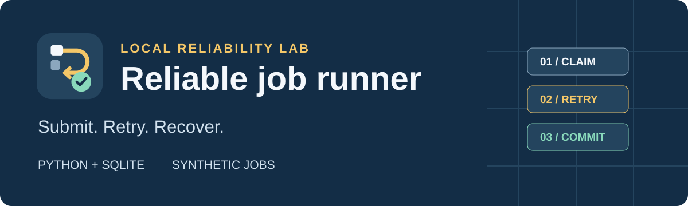
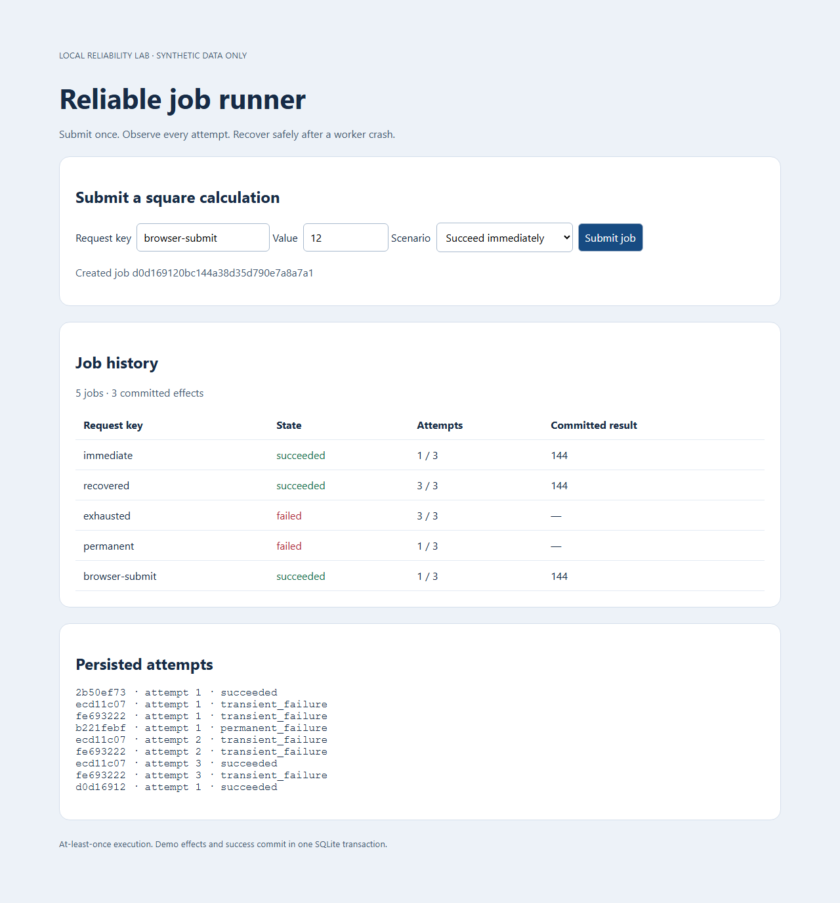
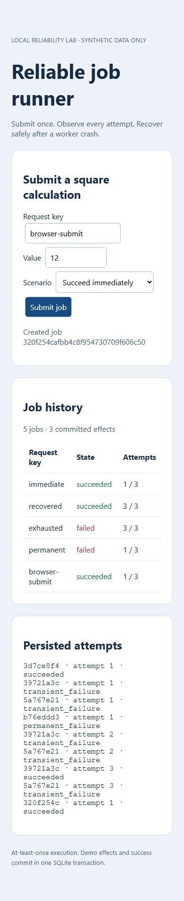
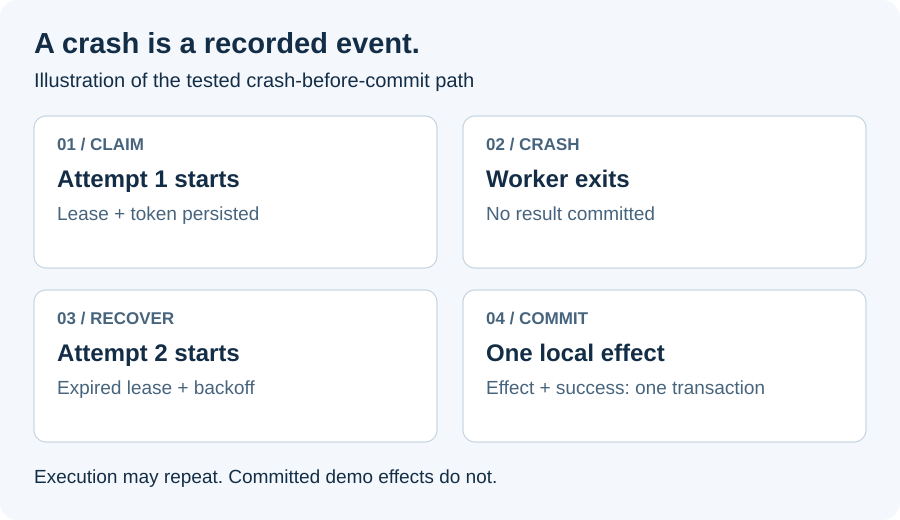

# Reliable job runner

A small, AI-assisted learning demo: HTTP submission → durable SQLite history → independent worker → synthetic square calculation. Python 3.11+ standard library only for the app and tests. Runs on localhost; no deployment, credentials, arbitrary commands or external side effects.

**Real software, synthetic data.** These are actual headless-browser captures from the running app, not mockups. The history shows immediate success, two transient failures followed by success, exhausted retries, and permanent failure.



<p align="center">
  <a href="docs/dashboard-mobile.png"></a>
</p>

## When a worker disappears



1. A worker claims a job and records its lease, fencing token and attempt.
2. It dies before committing a result. The expired attempt remains in history.
3. After lease expiry and backoff, another worker claims with a new token.
4. The result and success state commit together. A stale worker cannot commit.

This diagram illustrates the real subprocess crash test. The photos above show app execution with synthetic failures; they do not depict a process crash. **Execution can repeat; committed local demo effects remain unique.** [Read the exact validation evidence](docs/VALIDATION.md).

## Run on Windows

Open PowerShell in this repository. Check `python --version` (or substitute `py -3` for `python`).

Terminal 1:
```powershell
python runner.py api
```
Terminal 2, in the same repository:
```powershell
python runner.py worker
```
Open **http://127.0.0.1:8765**. Keep both terminals open; Ctrl+C stops each. Both commands must use the same working directory, or pass the same absolute `--db` path. The database persists across restarts and is excluded from Git. Port 8080 is never used. Use `--port 8767` if 8765 is occupied.

Choose a scenario, submit, and watch history. Re-submit the same key and identical payload to retrieve the same job. Change a value with that key to see a conflict. Use a fresh key for another job.

API example:
```powershell
$body = @{key='api-demo'; payload=@{value=12; failures=2; permanent=$false; max_attempts=3}} | ConvertTo-Json
Invoke-RestMethod http://127.0.0.1:8765/api/jobs -Method Post -ContentType application/json -Body $body
Invoke-RestMethod http://127.0.0.1:8765/api/jobs
```

## Verify

```powershell
python -m unittest -v
```
Optional existing Playwright installation and browser runtime:
```powershell
python qa_demo.py
```
The QA command uses its own temporary database, localhost port 8766 and a new headless browser. It does not control an existing Chrome window. See [validation](docs/VALIDATION.md) for actual results and limitations.

## Why this architecture

One database and two processes keep failure boundaries visible without a framework or broker. `BEGIN IMMEDIATE` serializes submission and claim transactions. A unique request key persists duplicate protection; canonical payload equality rejects key reuse for another request. Validation allows only bounded synthetic inputs. States are `queued`, `running`, `retry_wait`, `succeeded`, `failed`.

Claims record an attempt and a random fencing token with a five-second lease. Workers do their calculation outside the claim transaction, then validate the token and unexpired lease before committing. The result effect and success state commit together. Recovery closes expired attempts, consumes their attempt budget, and schedules bounded exponential backoff (1, 2, 4, capped at 8 seconds). Permanent failures stop immediately; transient failures stop at the configured total attempt count, including crashed attempts. Idle workers perform recovery when claiming. There is no background recovery without a worker.

This is **at-least-once execution**, subject to bounded attempts: computation may run again after a crash. The unique effect row and atomic local transaction prevent duplicate *committed demo effects*. This does not provide exactly-once execution or exactly-once remote effects. An email or payment could succeed just before a process dies; retry needs the receiving system's durable idempotency key, an outbox plus deduplicating consumer, or reconciliation. SQLite cannot roll back another service.

The lease is appropriate only for the instantaneous square job. There is no heartbeat; long jobs require lease renewal and stronger operational handling. SQLite is a single-host choice with serialized writes, not evidence of distributed scale. No authentication or TLS is provided: do not expose this service beyond localhost. Same-origin browser writes are checked, input is bounded, SQL uses parameters, dashboard uses text nodes, and logs omit request content. History is unpaginated for this small demo; upgrade before accumulating large histories. The standard-library HTTP server is for local learning.

## Project evidence

- [Five-minute walkthrough and unaided practice checkpoint](docs/WALKTHROUGH.md)
- [Requirement mapping and maintenance](docs/PROJECT.md)
- [Validation and review](docs/VALIDATION.md)

AI assisted the implementation, tests and documentation. Independent review is recorded honestly in validation. The owner should complete the unaided checkpoint before presenting this as understood work. This is a project demonstration, not employer endorsement, production experience, or proof of eligibility.
